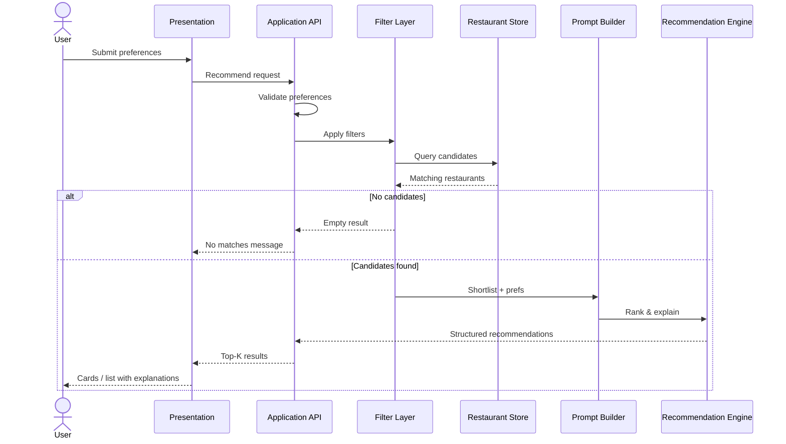

# Architecture — AI-Powered Restaurant Recommendation System

## 1. Overview

This system recommends restaurants by combining **deterministic filtering** on a real Zomato dataset with **LLM-based ranking and explanation**. Hard constraints (location, budget, cuisine, rating) are applied first; the LLM then reasons over the shortlisted set to produce personalized, human-readable recommendations.

```text
┌─────────────┐    ┌──────────────┐    ┌─────────────────┐    ┌──────────────────┐    ┌────────────┐
│ User Input  │───▶│ Filter Layer │───▶│ Prompt Builder  │───▶│ Recommendation   │───▶│ UI / API   │
│ (prefs)     │    │ (structured) │    │ (context pack)  │    │ Engine (LLM)     │    │ Output     │
└─────────────┘    └──────┬───────┘    └─────────────────┘    └──────────────────┘    └────────────┘
                          │
                          ▼
                   ┌──────────────┐
                   │ Restaurant   │
                   │ Data Store   │
                   │ (preprocessed│
                   │  Zomato)     │
                   └──────────────┘
```

### Design principles

| Principle | How it applies |
| --- | --- |
| Filter first, generate second | Reduce LLM context to a relevant shortlist; avoid hallucinating restaurants not in the dataset |
| Structured + generative | Rules handle constraints; LLM handles ranking, nuance, and explanations |
| Explainability | Every recommendation includes a clear, preference-aligned rationale |
| Separation of concerns | Ingestion, filtering, prompting, inference, and presentation are distinct modules |

---

## 2. High-Level Layers

| Layer | Responsibility |
| --- | --- |
| **Presentation** | Collect preferences; display ranked results and explanations |
| **API / Application** | Orchestrate request lifecycle; validate input; return response DTOs |
| **Filtering / Integration** | Apply preference filters; build LLM context from shortlisted rows |
| **Recommendation Engine** | Call LLM; parse ranked output and explanations |
| **Data** | Load, clean, and serve the Zomato restaurant dataset |

---

## 3. Component Architecture

### 3.1 Data Ingestion Module

**Purpose:** Prepare a clean, queryable restaurant catalog from Hugging Face Zomato data.

**Responsibilities:**

- Download / load the Zomato dataset from Hugging Face
- Select and normalize fields: name, location, cuisine, cost, rating (and optional attributes such as restaurant type, votes, online ordering)
- Clean missing or malformed values (ratings as numeric, cost as comparable ranges)
- Map approximate cost into budget buckets: `low` | `medium` | `high`
- Persist a processed artifact (e.g., CSV / Parquet / in-memory DataFrame) for filtering

**Outputs:**

- `restaurants` table/dataset with a stable schema
- Optional lookup indexes on `location`, `cuisine`, `budget_bucket`, `rating`

```text
Hugging Face Dataset
        │
        ▼
  Load & Schema Map
        │
        ▼
  Clean / Normalize / Budget Bucket
        │
        ▼
  Processed Restaurant Store
```

### 3.2 User Input Module

**Purpose:** Capture and validate preference signals used for filtering and prompting.

**Preference schema:**

| Field | Type | Example | Role |
| --- | --- | --- | --- |
| `location` | string | Bangalore | Hard filter |
| `budget` | enum: low / medium / high | medium | Hard filter (cost bucket) |
| `cuisine` | string or list | Italian, Chinese | Hard / soft filter |
| `min_rating` | number | 4.0 | Hard filter |
| `additional_preferences` | free text or tags | family-friendly, quick service | Soft signal for LLM |
| `top_k` | integer (optional) | 5 | Limit results |

**Validation rules:**

- Required: `location`, `budget` (or cost bounds), `min_rating` (default allowed)
- Normalize cuisine casing and aliases
- Bound `top_k` (e.g., 3–10) to keep prompts small and UI focused

### 3.3 Integration / Filter Layer

**Purpose:** Turn preferences into a **shortlist** of candidate restaurants, then package them for the LLM.

**Pipeline:**

1. **Hard filters** — location match, budget bucket, cuisine containment, rating ≥ `min_rating`
2. **Candidate cap** — if too many matches, keep top N by rating/votes before LLM (e.g., 15–30)
3. **Context serialization** — convert each candidate into a compact structured record for the prompt
4. **Prompt assembly** — combine system instructions, user preferences, and candidate list

**Why this layer exists:** The LLM should rank and explain *known* restaurants, not invent venues. Filtering guarantees grounding in the dataset.

```text
User Preferences
       │
       ▼
 Hard Filters ──▶ Candidate Shortlist ──▶ Prompt Context Pack
       │
       └── empty shortlist? ──▶ return graceful “no matches” (skip LLM)
```

### 3.4 Recommendation Engine (LLM)

**Purpose:** Rank shortlisted restaurants and generate human-like explanations.

**Capabilities:**

- Rank candidates by fit to preferences (including soft preferences)
- Explain *why* each pick matches (location, budget, cuisine, rating, extras)
- Optionally produce a short overall summary of the recommendation set

**Inputs to LLM:**

- System role: recommendation assistant constrained to the provided candidates
- User preferences (structured + free-text extras)
- Candidate restaurant records (name, cuisine, rating, cost, location, optional tags)

**Outputs from LLM (structured preferred):**

```json
{
  "summary": "optional overall blurb",
  "recommendations": [
    {
      "restaurant_name": "string",
      "cuisine": "string",
      "rating": 4.2,
      "estimated_cost": "medium",
      "rank": 1,
      "explanation": "why this fits the user"
    }
  ]
}
```

**Guardrails:**

- Instruct the model to only recommend restaurants from the provided list
- Prefer JSON / schema-constrained output for reliable UI binding
- Fallback: if parse fails, retry once or degrade to filter-sorted list with template explanations

### 3.5 Output / Presentation Layer

**Purpose:** Show top recommendations in a clear, useful format.

**Per-item display fields:**

- Restaurant Name
- Cuisine
- Rating
- Estimated Cost
- AI-generated explanation

**UX notes:**

- Show rank order explicitly
- Surface applied filters so users understand the shortlist
- Handle empty results with suggestions (widen cuisine, lower min rating, change budget)

---

## 4. End-to-End Request Flow



---

## 5. Data Model

### 5.1 Restaurant (processed)

| Field | Description |
| --- | --- |
| `id` | Stable identifier |
| `name` | Restaurant name |
| `location` | Area / city locality |
| `cuisines` | List or comma-separated cuisines |
| `rating` | Numeric rating |
| `votes` | Optional popularity signal |
| `approx_cost` | Numeric or original cost-for-two |
| `budget_bucket` | `low` / `medium` / `high` |
| `rest_type` | Optional (e.g., Casual Dining, Quick Bites) |
| `attributes` | Optional flags used for soft matching |

### 5.2 Recommendation Request

| Field | Description |
| --- | --- |
| `location` | Target area |
| `budget` | Budget enum |
| `cuisine` | Desired cuisine(s) |
| `min_rating` | Minimum acceptable rating |
| `additional_preferences` | Soft preferences text/tags |
| `top_k` | Number of results to return |

### 5.3 Recommendation Response

| Field | Description |
| --- | --- |
| `summary` | Optional LLM overview |
| `items[]` | Ranked recommendations |
| `items[].name` | Restaurant name |
| `items[].cuisine` | Cuisine |
| `items[].rating` | Rating |
| `items[].estimated_cost` | Cost / budget alignment |
| `items[].explanation` | AI rationale |
| `meta.candidate_count` | How many restaurants entered the LLM |
| `meta.filters_applied` | Echo of hard filters |

---

## 6. Prompt Architecture

### System prompt (intent)

- Act as a restaurant recommendation assistant
- Use **only** restaurants in the candidate list
- Rank by overall fit to preferences
- Write concise, specific explanations referencing preference factors
- Return valid JSON matching the response schema

### User / context prompt (payload)

1. Preferences block (location, budget, cuisine, min rating, extras)
2. Candidate restaurants block (compact bullet or JSON array)
3. Output instructions (`top_k`, schema reminder)

### Prompt sizing strategy

- Cap candidates before prompt construction
- Truncate long free-text fields (reviews, menus) — prefer structured columns only
- Keep explanations short (1–2 sentences) for UI readability

---

## 7. Suggested Tech Stack

| Area | Suggested choices | Notes |
| --- | --- | --- |
| Language | Python 3.11+ | Strong data + LLM ecosystem |
| Data | `pandas` / `polars`, Hugging Face `datasets` | Ingestion and filtering |
| API | FastAPI | Typed request/response models |
| LLM | **Groq** (OpenAI-compatible API) | `LLM_BASE_URL=https://api.groq.com/openai/v1`; JSON-mode preferred |
| Frontend | Streamlit, Gradio, or React | Streamlit/Gradio for fast MVP; React for product UI |
| Config | `.env` + settings module | API keys, model name, `top_k`, candidate cap |
| Persistence | Processed Parquet/CSV (MVP); SQLite later | Enough for single-machine demos |

**MVP path:** Python + pandas filter layer + LLM API + Streamlit UI.  
**Production path:** FastAPI service, cached processed dataset, structured LLM outputs, React client.

---

## 8. Logical Module Layout

```text
Zomato/
├── docs/
│   ├── problemStatement.md
│   └── architecture.md
├── data/
│   ├── raw/                  # optional cached Hugging Face download
│   └── processed/            # cleaned restaurant store
├── src/
│   ├── ingestion/
│   │   ├── load_dataset.py
│   │   └── preprocess.py
│   ├── filtering/
│   │   └── restaurant_filter.py
│   ├── llm/
│   │   ├── prompt_builder.py
│   │   ├── recommender.py
│   │   └── schemas.py
│   ├── api/                  # optional FastAPI app
│   │   └── main.py
│   └── ui/                   # Streamlit / frontend
│       └── app.py
├── tests/
└── requirements.txt
```

---

## 9. Non-Functional Considerations

| Concern | Approach |
| --- | --- |
| Latency | Filter locally; send only shortlist to LLM; cache processed dataset in memory |
| Cost | Cap candidate count and `top_k`; prefer smaller/faster models for ranking |
| Reliability | Validate LLM JSON; fallback to rating-sorted shortlist if LLM fails |
| Grounding | Never recommend outside the filtered candidate set |
| Privacy | No PII required; store only preference payloads needed for the request |
| Observability | Log filter counts, LLM latency, parse success/failure |

---

## 10. Architecture Decision Summary

1. **Hybrid retrieval + generation** — SQL/DataFrame filters retrieve; LLM ranks and explains.
2. **Grounded recommendations** — LLM context is limited to real dataset rows.
3. **Soft preferences via language** — family-friendly / quick service handled in the prompt, not only as brittle rules.
4. **Structured LLM output** — enables stable UI rendering and testing.
5. **Graceful degradation** — empty filters and LLM failures have defined fallbacks.

This architecture directly maps to the problem statement workflow: **Data Ingestion → User Input → Integration Layer → Recommendation Engine → Output Display**.
